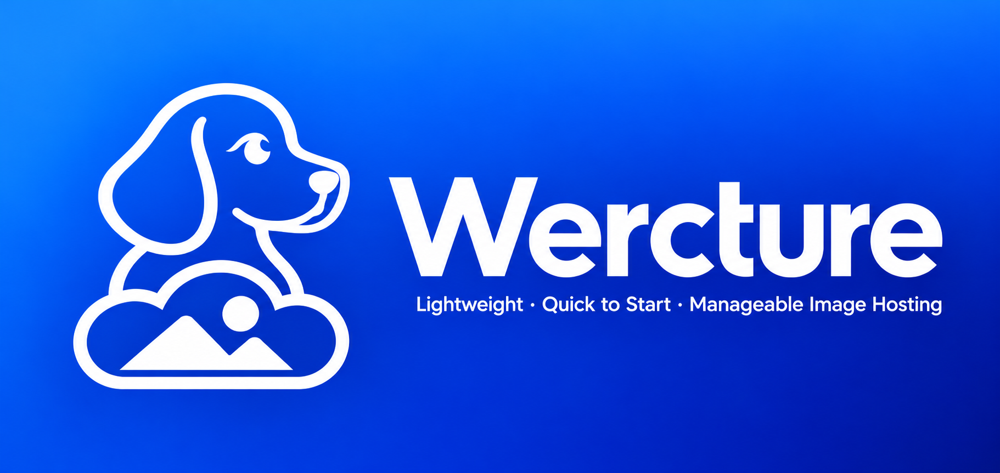

<p align="center"></p>

# Wercture

Wercture 是自托管图片、文档与音视频托管服务。Go 服务端提供嵌入式 Web 界面，使用 SQLite 存储元数据；原生客户端提供终端菜单和命令行上传。

[English](README.md) · [发布包](https://github.com/XLYing23333/Wercture/releases/latest)

## 功能

- 在仓库中管理 JPEG、PNG、GIF、WebP、PDF 和 Markdown 文件。
- 原样上传 MP4、WebM 视频，以及 MP3、M4A、AAC、WAV、OGG、FLAC 音频，不做转码。
- 视频使用自动生成的缩略图，音频使用统一音乐图标；主题播放器提供进度拖动、音量、静音和视频全屏控件。
- 在 Web 中管理用户、上传 token、文件和回收站。
- 分享公开直链；查看仓库列表需要登录。
- 上传前在客户端压缩图片或转换为 WebP。
- 在 Settings 设置所有文件共用的上传上限，默认 1024 MiB（1 GiB），仅管理员可修改。
- 原文件上传和仓库复制采用流式处理，避免整文件缓冲。
- 服务端使用 Docker，Linux 客户端为独立可执行文件。

## 服务端安装

从[发布页](https://github.com/XLYing23333/Wercture/releases/latest)下载适合主机架构的服务端压缩包及 `SHA256SUMS`。使用校验清单验证压缩包，解压到固定目录并打开管理菜单：

```sh
sha256sum -c --ignore-missing SHA256SUMS
sudo install -d -m 700 /opt/wercture
sudo tar -xzf wercture-server_*.release.tar.gz -C /opt/wercture
sudo /opt/wercture/manage
```

选择 **Install** 并提供数据目录的绝对路径，例如 `/var/lib/wercture`。管理程序导入镜像、启动容器、安装 systemd 单元并检查健康状态；开机自启需单独启用。安装会执行 `docker builder prune -af`，清理整个 Docker daemon 的未使用构建缓存，包括其他项目的缓存。

运行 `sudo /opt/wercture/manage status` 获取初始化地址，打开后创建管理员；系统没有默认凭据，请妥善保管该地址。初始化后用户名不可更改。Web 和 API 使用 **9416** TCP 端口及 HTTP；需要 HTTPS 时可配置外部反向代理。

```sh
sudo /opt/wercture/manage status
sudo /opt/wercture/manage start
sudo /opt/wercture/manage restart
sudo /opt/wercture/manage enable
sudo /opt/wercture/manage disable
sudo /opt/wercture/manage config reset-password
sudo /opt/wercture/manage update
sudo /opt/wercture/manage uninstall
```

服务端镜像内置 FFmpeg 和 FFprobe，用于音视频验证及视频缩略图，无需在宿主机安装 FFmpeg。

卸载保留数据目录。更新前备份完整数据目录和部署 `.env`；数据库不包含上传的文件。

## 客户端

从[发布页](https://github.com/XLYing23333/Wercture/releases/latest)下载对应架构的 `wercture-linux-amd64` 或 `wercture-linux-arm64` 及校验文件。校验后可运行 `sudo install -m 755 <下载文件> /usr/local/bin/wercture` 安装，也可以赋予执行权限后直接运行。

在终端运行 `wercture` 进入菜单。在 Web 中创建仓库和上传 token，再将其 `wercture://` 导入链接粘贴到客户端。配置保存在 `~/.config/wercture.db`，包含服务地址、token 和图片处理设置。

```sh
wercture import 'wercture://import?host=https%3A%2F%2Fimg.example.com&token=YOUR_TOKEN&name=personal'
wercture config list
wercture config use personal
wercture upload photo.jpg
wercture upload --compress --webp --quality 80 photo.png
wercture upload --pdf document.pdf
wercture upload --md notes.md
wercture upload --video clip.mp4
wercture upload --audio song.mp3
```

`--compress` 和 `--webp` 可以同时使用；`--none` 关闭两种处理。GIF 和动画 WebP 原样上传。PDF、Markdown、视频和音频分别需要 `--pdf`、`--md`、`--video`、`--audio` 参数。这些类型参数相互排斥，也不能与显式图片处理参数组合。配置中保存的图片处理开关不作用于音视频。TUI 提供图片、视频和音频上传类型选择。完整命令见 `wercture --help`。

## 访问与链接

管理员管理用户和全部仓库，普通用户管理自己的仓库。上传 token 只能向所属仓库上传。直链公开，仓库列表需要登录。音视频直链返回原文件，支持字节范围请求，可直接播放和拖动进度。播放能力取决于浏览器对文件编码的支持，网页播放器同时提供下载入口。复制音视频 Markdown 得到普通链接，复制 HTML 得到可播放的媒体嵌入代码。

Markdown 直链显示排版后的文档，添加 `?raw=1` 可获取源文件。删除的文件进入管理员回收站，期间直链不可访问；文件可以恢复或彻底删除，72 小时后自动清理。

## 构建与测试

使用模块中指定的 Go 版本和 Node.js 22.13 或更高版本；直接运行服务端还需要在 `PATH` 中提供 FFmpeg 和 FFprobe。

支持的类型、API 设置和大文件处理详见[音视频与上传配置说明](docs/media.md)。

```sh
cd WerctureServer/web
npm ci
npm run build
npm run typecheck
cd ..
go test ./...
CGO_ENABLED=0 go build -trimpath -o wercture-server ./cmd/wercture-server
cd ../WerctureClient
go test ./...
CGO_ENABLED=0 go build -trimpath -o wercture ./cmd/wercture
```

在仓库根目录运行部署测试：`python3 -m unittest discover -s WerctureServer/deploy/docker -p 'test_*.py'`。
