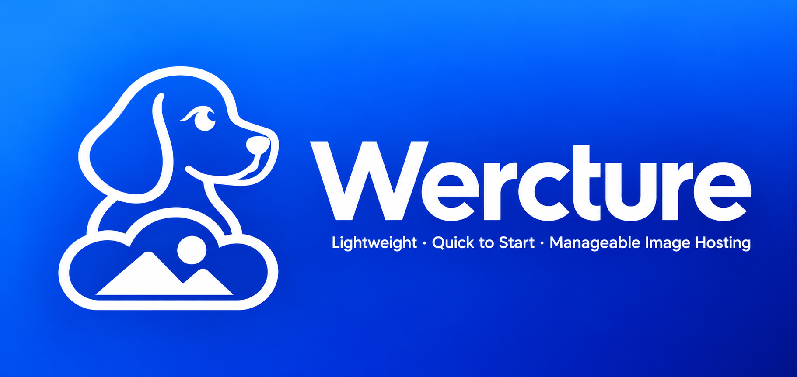

<p align="center"></p>

# Wercture

Wercture is a self-hosted image, document, audio, and video host. Its Go server serves an embedded web interface and stores metadata in SQLite. A native client provides a terminal interface and command-line uploads.

[Chinese](README-CN.md) · [Releases](https://github.com/XLYing23333/Wercture/releases/latest)

## Features

- Organize JPEG, PNG, GIF, WebP, PDF, and Markdown files in warehouses.
- Upload MP4 and WebM videos, plus MP3, M4A, AAC, WAV, OGG, and FLAC audio without transcoding.
- Preview videos with generated thumbnails and audio with a shared music icon; play both with themed controls for seeking, volume, mute, and video fullscreen.
- Manage users, upload tokens, files, and the recycle bin from the web interface.
- Share public direct links; warehouse listings require authentication.
- Compress images or convert them to WebP on the client before upload.
- Set a global file upload limit in Settings; the default is 1024 MiB (1 GiB), editable by the administrator.
- Stream original uploads and warehouse copies without buffering whole files.
- Use a Docker server and a standalone Linux client.

## Server installation

Download the server archive for the host architecture and `SHA256SUMS` from the [releases page](https://github.com/XLYing23333/Wercture/releases/latest). Verify the downloaded archive using its checksum entry, extract it to a persistent directory, and open the management menu:

```sh
sha256sum -c --ignore-missing SHA256SUMS
sudo install -d -m 700 /opt/wercture
sudo tar -xzf wercture-server_*.release.tar.gz -C /opt/wercture
sudo /opt/wercture/manage
```

Select **Install** and provide an absolute data directory, such as `/var/lib/wercture`. The manager imports the image, starts the container, installs the systemd unit, and checks health. Enable autostart separately. Installation runs `docker builder prune -af`, which removes unused build cache across the Docker daemon, including cache belonging to other projects.

Run `sudo /opt/wercture/manage status` to obtain the initialization URL. Open it to create the administrator; no default credentials are provided. Keep the URL private. The username cannot be changed after initialization. The web interface and API listen on TCP port **9416** and use HTTP; configure an external HTTPS reverse proxy if needed.

```sh
sudo /opt/wercture/manage status
sudo /opt/wercture/manage start
sudo /opt/wercture/manage restart
sudo /opt/wercture/manage enable
sudo /opt/wercture/manage disable
sudo /opt/wercture/manage config reset-password
sudo /opt/wercture/manage update
sudo /opt/wercture/manage uninstall
```

The server image includes FFmpeg and FFprobe for media validation and video thumbnails; no host FFmpeg installation is required.

Uninstall retains the data directory. Back up the complete data directory and deployment `.env` before updating; the database alone does not include uploaded files.

## Client

Download the matching `wercture-linux-amd64` or `wercture-linux-arm64` executable and checksum file from the [releases page](https://github.com/XLYing23333/Wercture/releases/latest). Verify the executable and install it with `sudo install -m 755 <downloaded-file> /usr/local/bin/wercture`, or make it executable and run it directly.

Run `wercture` in a terminal for the menu. Create a warehouse and upload token in the web interface, then import its `wercture://` URL in the client. Profiles are stored in `~/.config/wercture.db` with server address, token, and image processing preferences.

```sh
wercture import 'wercture://import?host=https%3A%2F%2Fimg.example.com&token=YOUR_TOKEN&name=personal'
wercture config list
wercture config use personal
wercture upload photo.jpg
wercture upload --compress --webp --quality 80 photo.png
wercture upload --pdf document.pdf
wercture upload --md notes.md
wercture upload --video clip.mp4
wercture upload --audio song.mp3
```

`--compress` and `--webp` can be combined; `--none` disables both. GIF and animated WebP are uploaded unchanged. PDF, Markdown, video, and audio require their respective `--pdf`, `--md`, `--video`, and `--audio` flags. These type flags are mutually exclusive and cannot be combined with explicit image processing options. Saved image processing preferences do not affect audio or video. The TUI offers image, video, and audio upload types. `wercture --help` describes the CLI.

## Access and links

Administrators manage users and all warehouses; users manage their own warehouses. Upload tokens allow uploads only to their associated warehouse. Direct links are public, while warehouse listings require login. Audio and video links return the original file with byte-range support for direct playback and seeking. Playback depends on browser codec support; the web player also provides a download action. Audio/video Markdown copies are ordinary links, and HTML copies are playable media embeds.

Markdown links render the document; append `?raw=1` for the source. Deleted files enter the administrator's recycle bin, where direct links are unavailable. They can be restored or permanently deleted and are automatically removed after 72 hours.

## Build and test

Use the Go version in the modules and Node.js 22.13 or later. Running the server directly also requires FFmpeg and FFprobe in `PATH`:

See [media uploads and upload settings](docs/media.md) for supported types, API settings, and large-file behavior.

```sh
cd WerctureServer/web
npm ci
npm run build
npm run typecheck
cd ..
go test ./...
CGO_ENABLED=0 go build -trimpath -o wercture-server ./cmd/wercture-server
cd ../WerctureClient
go test ./...
CGO_ENABLED=0 go build -trimpath -o wercture ./cmd/wercture
```

From the repository root, deployment tests run with `python3 -m unittest discover -s WerctureServer/deploy/docker -p 'test_*.py'`.
