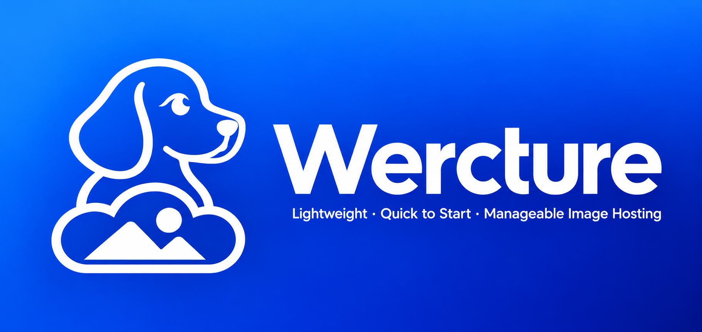

<p align="center">
  
</p>

<h1 align="center">Wercture</h1>

<p align="center">
  <strong>Self-hosted image hosting · Go client · Docker server · Embedded Web</strong>
</p>

<p align="center">
  
  
  
  
  
</p>

<p align="center">
  <strong>English</strong> · <a href="README-CN.md">简体中文</a> · <a href="#server-setup">Server setup</a> · <a href="#client-setup">Client setup</a> · <a href="#project-structure">Project structure</a>
</p>

---

Wercture is a lightweight, self-hosted image host with private warehouse management and public direct links. The Go server serves an embedded Vue dashboard and stores metadata in SQLite. A single Go client provides both a terminal menu and a scriptable CLI, with optional local compression and WebP conversion before upload.

JPEG, PNG, GIF and WebP are supported, alongside PDF and Markdown with document previews. The interface, initialization flow and settings follow the companion project [Weroxy](https://github.com/XLYing23333/Weroxy).

## Features

| | What you get |
| :--- | :--- |
| **Small deployment** | One Docker service, one HTTP port and a persistent data directory. Go serves the dashboard directly. |
| **Private management** | Admin-created accounts, individually owned warehouses and multiple revocable upload tokens per warehouse. |
| **Stable public links** | Random IDs with format suffixes; renaming, moving and restoring a file preserve its link. |
| **Gallery controls** | Click to preview, wheel to zoom images, right-click menus and a batch action bar. |
| **Documents included** | PDF reader, formatted Markdown with tables and math, and preview images in the gallery. |
| **Local processing** | Independent compression and WebP switches, implemented in Go without external image tools. |
| **Recoverable deletion** | Admin-only trash, restore or move to another warehouse, and automatic deletion after 3 days. |
| **Shared appearance** | English / 简体中文 and System / Light / Dark, configured site-wide by the admin. |

### Contents

[Packages](#packages) · [Server setup](#server-setup) · [Client setup](#client-setup) · [CLI usage](#cli-usage) · [Web and permissions](#web-and-permissions) · [Direct links and trash](#direct-links-and-trash) · [Build and verify](#build-and-verify) · [Project structure](#project-structure) · [Acknowledgements](#acknowledgements)

## Packages

| Component | Distribution | Architecture |
| :--- | :--- | :--- |
| **WerctureServer** | Docker image archive, `manage`, deployment files and checksums | Linux amd64 |
| **WerctureClient** | Single static executable, with TUI and CLI | Linux amd64 / arm64 |

[GitHub repository](https://github.com/XLYing23333/Wercture) · [v0.1.0 Release](https://github.com/XLYing23333/Wercture/releases/tag/v0.1.0)

| Download | Platform |
| :--- | :--- |
| [Server](https://github.com/XLYing23333/Wercture/releases/download/v0.1.0/wercture-server_0.1.0_linux_amd64.release.tar.gz) | Linux amd64 |
| [Client amd64](https://github.com/XLYing23333/Wercture/releases/download/v0.1.0/wercture-linux-amd64) | Linux amd64 |
| [Client arm64](https://github.com/XLYing23333/Wercture/releases/download/v0.1.0/wercture-linux-arm64) | Linux arm64 |
| [SHA-256](https://github.com/XLYing23333/Wercture/releases/download/v0.1.0/SHA256SUMS) | All release assets |

The Release uses one `SHA256SUMS` covering the Server archive and both Client binaries.

The commands below install **v0.1.0** from GitHub Releases. For source builds, see [Build and verify](#build-and-verify). Server bundles include the Docker image, so installation needs no source checkout, Go or Node.js. The Client executable needs no package manager installation or external image tools.

## Server setup

Target systems are Debian 11 / 12 / 13 and Ubuntu 20 / 22 / 24 / 26. The server runs in Docker; the host manager requires Python 3.9+, Docker Engine, the Compose plugin and systemd. Install these prerequisites and make TCP port **9416** reachable before deployment.

### 1. Download, verify and open the manager

The prebuilt Server image is **Linux amd64**. Download the release, verify the archive and its extracted contents, then open the terminal manager:

```sh
set -eu
case "$(uname -m)" in
  x86_64) ;;
  *) echo "Server release supports Linux amd64 only"; exit 1 ;;
esac
release=https://github.com/XLYing23333/Wercture/releases/download/v0.1.0
work=$(mktemp -d)
cd "$work"
pkg=wercture-server_0.1.0_linux_amd64.release.tar.gz
wget "$release/$pkg"
wget "$release/SHA256SUMS"
awk -v name="$pkg" '$2 == name { print; found = 1 } END { if (!found) exit 1 }' SHA256SUMS > SHA256SUMS.server
sha256sum -c SHA256SUMS.server
sudo install -d -m 700 /opt/wercture
sudo tar -xzf "$pkg" -C /opt/wercture
sudo sh -c 'cd /opt/wercture && sha256sum -c SHA256SUMS'
sudo /opt/wercture/manage
```

Choose **Install**, then enter an absolute storage path, for example `/var/lib/wercture`. The manager imports the bundled image, starts the container, installs `wercture.service` and checks `/health`.

To install without the menu, specify the storage path explicitly:

```sh
sudo /opt/wercture/manage install --data /var/lib/wercture
sudo /opt/wercture/manage status
```

An existing Wercture storage directory can be loaded during installation. Keep `/opt/wercture` in place: the systemd unit points to that directory. Installation does not enable boot startup; choose **Enable** separately. Run the Client as your normal user; only server management and installation require elevated privileges.

> [!IMPORTANT]
> Install removes the previous deployment containers and `wercture-server` images. It also runs `docker builder prune -af`, which clears unused build cache across the Docker daemon, including cache from other projects. The selected data directory is retained.

### 2. Initialize the administrator

Run `sudo /opt/wercture/manage status` to see the random initialization URL:

```text
http://127.0.0.1:9416/init<64-hex-token>
```

Replace `127.0.0.1` with the server address when opening it remotely. Create the first administrator with a username and password. There are no default credentials; the username cannot be changed afterward. Passwords must be 6–1024 bytes. The setup URL expires after successful initialization; normal access is then `http://<server-IP>:9416/`.

### 3. Create a warehouse and upload

1. Sign in and create a warehouse.
2. Upload images, PDFs or Markdown directly from its Web page.
3. For the client or scripts, create an upload token and copy its `wercture://import?...` link.
4. Create other users from **Users**. Share each activation link with its intended user so they can set their password.

When deleting a user, choose **Move to trash** or **Delete now**; the latter permanently removes their warehouses and files.

There is no public registration. Each warehouse has one owner, and each token uploads only to its assigned warehouse.

### Management commands

The menu and CLI share the same implementation. Use arrows to select, Enter to execute, Esc to return and Q to exit. The commands below use `/opt/wercture`; inside the extracted directory, you can also use `sudo ./manage`.

| Operation | Command |
| :--- | :--- |
| Install / load an existing data directory | `sudo /opt/wercture/manage install --data /var/lib/wercture` |
| Start | `sudo /opt/wercture/manage start` |
| Restart | `sudo /opt/wercture/manage restart` |
| Status and setup URL | `sudo /opt/wercture/manage status` |
| Enable boot startup | `sudo /opt/wercture/manage enable` |
| Disable boot startup | `sudo /opt/wercture/manage disable` |
| Reset the admin password | `sudo /opt/wercture/manage config reset-password` |
| Set the site language | `sudo /opt/wercture/manage config language zh-CN` |
| Check for a stable GitHub release and update | `sudo /opt/wercture/manage update` |
| Uninstall, retaining data | `sudo /opt/wercture/manage uninstall` |

Use `en` for English. Start / Restart affect the current runtime; Enable / Disable affect only boot startup. Password reset keeps the admin username. Uninstall removes this deployment's containers, systemd unit and `wercture-server` images while preserving stored files and settings.

### Network and storage

The dashboard, upload API and public links share **9416/tcp**. Go serves the Web assets directly over HTTP. **If SSL/HTTPS is needed, configure it yourself outside Wercture.** Clipboard actions work best over HTTPS or localhost.

The storage directory is mounted at `/data`:

```text
/data/
├── wercture.db       # Accounts, settings, warehouses, tokens and file metadata
├── files/            # Uploaded originals and document preview images
└── setup.secret      # Present only before administrator initialization
```

The container runs as UID/GID `10001:10001`, with a read-only root filesystem and dropped capabilities. The manager prepares storage permissions and records the chosen path in `/opt/wercture/.env`.

### Updates and backups

For a released version, use **Update** or extract the verified new bundle into `/opt/wercture` and choose **Install** with the original storage directory. A release installation imports the bundled image. Source deployments use `WerctureServer/deploy/docker/manage` and rebuild from the checkout; after local server or Web changes, run its **Install** action with the same data directory. **Restart** alone continues using the existing image.

The **Update** action checks GitHub stable releases for a matching architecture, verifies SHA-256 and replaces the packaged image and manager. It requires a published server bundle and `SHA256SUMS`; it does not build local changes. The updater uses `.update-previous` for automatic rollback during the update and removes it after success. Keep a separate backup for later recovery. The verified image archive and checksum manifest stay in the deployment directory for reinstallation.

Before updating, stop the deployment and back up the complete storage directory together with the deployment `.env`. The database alone does not contain uploaded files. Keep the previous source or release bundle for recovery.

## Client setup

Download the binary matching your architecture, verify it and install it as `wercture`:

```sh
set -eu
case "$(uname -m)" in
  x86_64) arch=amd64 ;;
  aarch64|arm64) arch=arm64 ;;
  *) echo "Unsupported architecture: $(uname -m)"; exit 1 ;;
esac
release=https://github.com/XLYing23333/Wercture/releases/download/v0.1.0
work=$(mktemp -d)
cd "$work"
pkg="wercture-linux-$arch"
wget "$release/$pkg"
wget "$release/SHA256SUMS"
awk -v name="$pkg" '$2 == name { print; found = 1 } END { if (!found) exit 1 }' SHA256SUMS > SHA256SUMS.client
sha256sum -c SHA256SUMS.client
sudo install -m 755 "$pkg" /usr/local/bin/wercture
wercture version
wercture
```

This installs a single executable at `/usr/local/bin/wercture`; no Go toolchain is required. To run without installing system-wide, use `chmod +x "$pkg"` and `./"$pkg"` in the download directory instead. See [Build and verify](#build-and-verify) for source builds.

Run it without arguments in a terminal to open the TUI. Use arrows to select, Enter to execute, Esc to return and Q to exit. Without a terminal it prints usage instead of opening a menu.

```text
Import URL
Switch profile
Compress             on / off
WebP                 on / off
Upload files
Status
Delete current profile
Quit
```

Copy an import URL from a warehouse's token panel and paste it into **Import URL**. **Status** shows the active profile, masked token, processing switches and server connectivity. The TUI reads the selected server's site language; English is the fallback.

Profiles are stored in `~/.config/wercture.db` with file permissions `0600`. They contain the server address, upload token, compression/WebP settings and quality. Run the client as your normal user to use your own profiles.

## CLI usage

The following examples assume `wercture` is on `PATH`; otherwise use the built executable's path. All addresses and tokens below are placeholders.

### Import and manage profiles

```sh
wercture import 'wercture://import?host=https%3A%2F%2Fimg.example.com&token=YOUR_TOKEN&name=personal'

# Or create a profile manually
wercture config add personal --host https://img.example.com --token YOUR_TOKEN
wercture config list
wercture config use personal
wercture config edit personal --compress --webp --quality 80
wercture config edit personal --none

# Remove a local profile
wercture config rm personal
```

Import selects the profile automatically. Importing an existing name updates its address and token while retaining its processing preferences. Removing a profile only removes local configuration.

### Upload images

```sh
wercture upload photo.jpg screenshot.png
wercture upload --profile personal photo.jpg
wercture upload --compress --quality 80 photo.jpg
wercture upload --webp photo.png
wercture upload --compress --webp --quality 80 photo.png
wercture upload --none animation.gif

# Supply connection settings for this upload
wercture upload --host https://img.example.com --token YOUR_TOKEN photo.jpg
```

Explicit processing flags replace the saved processing mode for that invocation; omitting them uses the profile. `--none` turns both switches off and cannot be combined with `--compress` or `--webp`. Quality defaults to **80**, with a range of **1–100**.

| Compress | WebP | Result for still images |
| :---: | :---: | :--- |
| Off | Off | Original bytes. |
| On | Off | Same format and dimensions; JPEG/WebP use the quality setting, PNG is losslessly re-encoded. |
| Off | On | Lossless WebP conversion. |
| On | On | Lossy WebP conversion using the quality setting. |

Re-encoding removes extra metadata and preserves dimensions. GIF and animated WebP always pass through unchanged. Compression does not guarantee a smaller file. Processing happens locally in Go; no ImageMagick, `cwebp` or FFmpeg is needed. The server stores the uploaded result without further transcoding.

### Upload documents and choose link output

```sh
wercture upload --pdf document.pdf
wercture upload --md notes.md
wercture upload --link markdown photo.jpg
wercture upload --link html photo.jpg
```

PDF requires `--pdf`, and Markdown requires `--md`. These flags are mutually exclusive and cannot be combined with `--compress`, `--webp` or `--none`. Documents bypass saved image processing preferences. Web uploads accept documents directly without these flags. The per-file upload limit is **32 MiB**.

`--link` accepts `url` (default), `typora`, `obsidian`, `markdown` or `html`. The first three print a bare URL for the caller to embed; Markdown and HTML output image markup for images and ordinary links for documents. Each successful file produces one output line.

For an editor's custom upload command, use the executable's absolute path followed by `upload --link typora` or `upload --link obsidian`, then let the editor append image paths.

### Upload API

Scripts can upload one file per request with a warehouse token:

```sh
curl --fail-with-body https://img.example.com/api/v1/upload \
  -H 'Authorization: Bearer YOUR_TOKEN' \
  -F 'file=@photo.jpg'
```

The JSON response includes `url`, `markdown` and `html`; Markdown uploads also include `render_url`. The token grants upload access only, with no listing, rename, move or delete permissions.

## Web and permissions

| Action | Warehouse owner | Admin | Upload token |
| :--- | :--- | :--- | :--- |
| List warehouses and files | Own warehouses | All warehouses | — |
| Create a warehouse | Owned by the creator | Owned by the creator | — |
| Web upload, rename, copy, move and delete | Own warehouses | Any warehouse | — |
| Create and revoke tokens | Own warehouses | Any warehouse | — |
| Upload through the token API | With a token | With a token | Assigned warehouse |
| Users, trash, site language and theme | — | Yes | — |
| Change own password | Yes | Yes | — |

Admin actions do not transfer warehouse ownership. Users can move files only between their own warehouses; the admin can move files between any warehouses. Logged-in owners and admins upload from the Web without entering a token.

Click a gallery item to open it and use the wheel to zoom images. Right-click for link copying and file actions. Select the corner checkboxes for the bottom batch action bar, up to 100 files per operation. PDFs open in a reader; Markdown opens as a formatted document with tables and math.

## Direct links and trash

Warehouse lists and galleries require login. Direct links are public: anyone with a link can open the file without a login or token. There is no public site-wide directory.

```text
/i/<random-id>.jpg          Image in its stored format
/i/<random-id>.pdf          Original PDF file
/i/<random-id>.md           Formatted Markdown page
/i/<random-id>.html         Markdown rendering alias used by the client
/i/<random-id>.md?raw=1     Markdown source
```

Suffixless links remain supported. Renaming changes only the display name; moving a file preserves its ID and URL. Copying creates a separate file with a new ID and link.

Deleted files enter the admin-only trash and their public links stop working. Restore to the original warehouse when it still exists, or move the file to another warehouse; the original link becomes usable again. Deleting a warehouse sends its files to trash without a restore-to-original option. Files in trash for **72 hours** are permanently deleted by a cleanup task that runs at startup and once per minute. The admin can also delete them permanently sooner.

## Build and verify

Use Go **1.27.1** and Node.js **22.13+** with npm. Run commands from the repository root unless a working directory is specified.

```sh
# Build the Web assets embedded by the server
cd WerctureServer/web
npm ci
npm run build

# Build the server
cd ..
CGO_ENABLED=0 go build -trimpath -o wercture-server ./cmd/wercture-server

# Build the client
cd ../WerctureClient
CGO_ENABLED=0 go build -trimpath -o wercture ./cmd/wercture
```

Run the checks in their respective directories:

| Directory | Command |
| :--- | :--- |
| `WerctureServer` | `go test ./...` |
| `WerctureClient` | `go test ./...` |
| `WerctureServer/web` | `npm run typecheck` |
| `WerctureServer/web` | `node --experimental-strip-types --test src/markdown.test.ts src/selection.test.ts` |
| Repository root | `python3 -m unittest discover -s WerctureServer/deploy/docker -p 'test_*.py'` |

Build a standalone Docker image from the repository root:

```sh
docker build -t wercture-server:0.1.0 WerctureServer
```

To generate a server distribution bundle, first install Web dependencies with `npm ci` in `WerctureServer/web`, then run from the repository root:

```sh
python3 WerctureServer/deploy/package.py --version 0.1.0
```

This builds Web and Go on the host, packages a Docker image for the host architecture, and writes `wercture-server_0.1.0_linux_<arch>.release.tar.gz` plus `SHA256SUMS` under `dist/server/0.1.0/`. Supported package architectures are amd64 and arm64. Extract the bundle into a persistent directory and run its `sudo ./manage` entry point. When distributing or downloading a bundle, verify the archive against its accompanying `SHA256SUMS` before extraction.

The client can also be cross-compiled as a single Linux binary by setting `GOOS=linux`, `GOARCH=amd64` or `GOARCH=arm64`, and `CGO_ENABLED=0`.

## Project structure

```text
Wercture/
├── assets/                        # README banner and project logo
├── WerctureServer/
│   ├── cmd/wercture-server/        # HTTP server and maintenance commands
│   ├── internal/
│   │   ├── auth/                  # Password hashing and validation
│   │   ├── preview/               # PDF and Markdown preview generation
│   │   ├── server/                # HTTP API, permissions and public links
│   │   ├── store/                 # SQLite, warehouses, files and trash
│   │   └── webui/                 # Embedded Web assets, including dist/
│   ├── migrations/                # Embedded SQL migrations
│   ├── web/                       # Vue 3, TypeScript and Vite sources
│   ├── deploy/
│   │   ├── docker/                # manage, TUI, Compose, systemd and updates
│   │   └── package.py             # Server distribution builder
│   └── Dockerfile                 # Web/Go build and scratch runtime
├── WerctureClient/
│   ├── cmd/wercture/              # CLI and terminal menu
│   └── internal/
│       ├── config/                # Profiles, import URLs and overrides
│       ├── filekind/              # Image, PDF and Markdown detection
│       └── image/                 # Pure Go compression and WebP conversion
├── README.md                      # English guide
└── README-CN.md                    # 简体中文说明
```

Server and Client are separate Go modules. Web output is embedded from `WerctureServer/internal/webui/dist/`; rebuild it after frontend changes. Runtime requires neither Node.js nor an external database. Local `development/` reference sources and generated `dist/` packages are excluded from Git.

## Acknowledgements

Thanks to these projects and their contributors:

- [Weroxy](https://github.com/XLYing23333/Weroxy) for the companion UI, initialization and management design.
- [Go](https://go.dev/), [Vue](https://vuejs.org/), [Element Plus](https://element-plus.org/) and [SQLite](https://sqlite.org/) for the application foundations.
- [go-webp](https://github.com/mayahiro/go-webp) for local WebP encoding.
- [PDF.js](https://github.com/mozilla/pdf.js) and [go-pdfium](https://github.com/klippa-app/go-pdfium) for PDF reading and preview rendering.
- [markdown-it](https://github.com/markdown-it/markdown-it) and [MathJax](https://github.com/mathjax/MathJax) for Markdown and mathematical typesetting.

---

<p align="center">
  <a href="README-CN.md">简体中文</a> · <a href="#wercture">Back to top</a>
</p>
